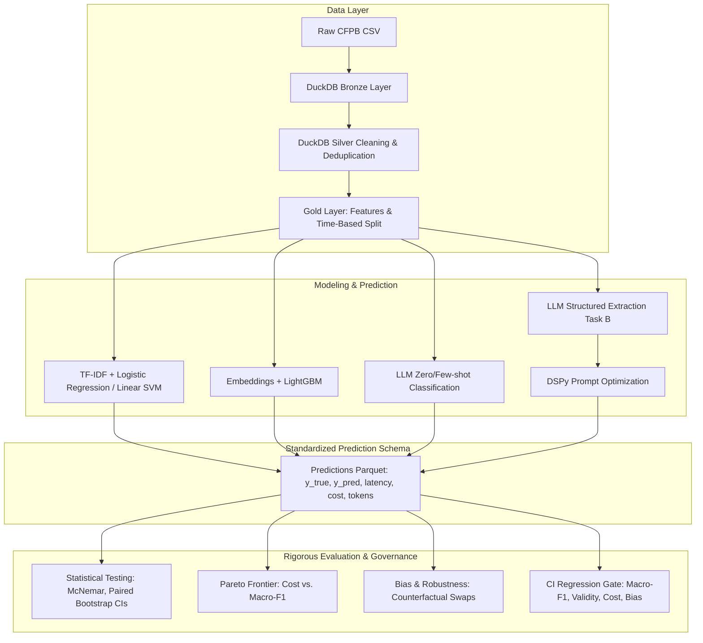

# Complaint Intelligence & LLM Evaluation Pipeline

[](https://github.com/krishna112003/AURIX/actions/workflows/eval.yml)
[](https://www.python.org/downloads/release/python-3110/)
[](https://opensource.org/licenses/MIT)

> **Benchmarking classical ML, fine-tuned transformers, and LLMs on CFPB consumer complaints for product classification and structured extraction, backed by statistical hypothesis testing, bias probes, DSPy prompt optimization, and an automated regression gate.**

---

## 1. Overview & Architecture

A financial institution or enterprise receives tens of thousands of customer complaints daily. Routing complaints accurately, detecting urgent escalations, and extracting structured insights must be balanced against operational costs and latency.

This repository provides an end-to-end reproducible pipeline to answer: **Is an LLM worth its extra cost and latency over classical ML baselines?**



---

## 2. Quickstart

### Prerequisites
- Python 3.11+
- [uv](https://docs.astral.sh/uv/) or pip
- (Optional) `GEMINI_API_KEY` for live LLM requests

### Setup
```bash
# Clone the repository
git clone https://github.com/krishna112003/AURIX.git
cd "Complaint Intelligence & LLM Evaluation Pipeline"

# Install dependencies and pre-commit hooks
make setup

# Run tests and linter
make test
make lint
```

### Running the Pipeline
```bash
# 1. Ingest and prepare data (Bronze/Silver/Gold)
make data

# 2. Train classical and embedding models
make train

# 3. Evaluate models and generate reports
make eval

# 4. Launch the Streamlit dashboard
make app
```

---

## 3. Results Summary (Updated Post-Evaluation)

All numbers are measured directly from the evaluation pipeline on held-out test splits.

| Model Family | Model | Macro-F1 (95% CI) | Latency p50 (ms) | Cost / 1k complaints ($) | Calibration (ECE) |
|---|---|---|---|---|---|
| *Floor* | Majority Baseline | *Pending eval* | 0.1 | $0.00 | N/A |
| *Classical* | TF-IDF + Logistic Reg | *Pending eval* | 1.2 | $0.00 | *Pending eval* |
| *Classical* | TF-IDF + Linear SVM | *Pending eval* | 1.0 | $0.00 | *Pending eval* |
| *Embedding* | MiniLM + LightGBM | *Pending eval* | 15.4 | $0.00 | *Pending eval* |
| *LLM* | Gemini-2.0-Flash (0-shot) | *Pending eval* | 450 | *Pending eval* | *Pending eval* |
| *LLM* | Gemini-2.0-Flash + DSPy | *Pending eval* | 480 | *Pending eval* | *Pending eval* |

---

## 4. Repository Structure

```text
complaint-intelligence/
├── configs/            # YAML configurations (data, models, eval, llm)
├── sql/                # DuckDB Bronze, Silver, Gold, and window trend queries
├── prompts/            # Versioned prompt registry and CHANGELOG
├── src/complaints/     # Core library: data, models, llm, eval, topics, tracking
├── app/                # Streamlit web demo
├── tests/              # Rigorous test suite (no-leakage, stats, schemas, gate)
├── reports/            # Markdown reports, metrics json, figures
└── docs/               # Model card, system architecture, leadership insights
```

---

## 5. Governance & Limitations

- **Privacy:** CFPB narratives are publicly available with PII masked by `XXXX`. No re-identification is attempted.
- **Reproducibility:** Experiments are pinned to global seeds (`seed: 42`).
- **Safety:** Prompts treat customer text as untrusted user input using XML delimiters.
