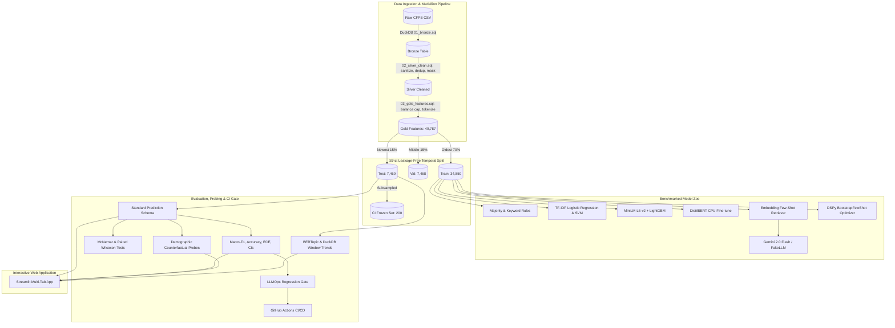

# Architecture & System Design

This document outlines the end-to-end design, data lineage, evaluation lifecycle, and governance controls of the **Complaint Intelligence & LLM Evaluation Pipeline**.

---

## 1. End-to-End System Architecture

---

## 2. Medallion Storage Lineage

1. **Bronze (`sql/01_bronze.sql`)**: Direct columnar reflection of the raw CFPB CSV. Retains raw types, dates, and consumer narratives.
2. **Silver (`sql/02_silver_clean.sql`)**: Cleans whitespace, drops empty or short narratives (<50 characters), deduplicates on narrative text and date, and standardizes dates.
3. **Gold (`sql/03_gold_features.sql`)**: Consolidates 18+ raw CFPB product labels into 10 clean business categories, applies a 10k per-class balance cap, extracts word counts, character lengths, and mask frequencies.

---

## 3. Strict Anti-Leakage Safeguards

- **Temporal Split Boundaries**: Splits are purely temporal—never randomly shuffled. The oldest 70% of complaints form the train split; the subsequent 15% form validation; the final 15% form the test split.
- **Embedding Retrieval Isolation**: The k-NN few-shot exemplar pool for LLM prompt augmentation only indexes representations from the training split.
- **Evaluation Caching**: All test predictions are serialized to immutable Parquet files with fixed schemas, preventing test-time feature re-fitting.

---

## 4. LLMOps Regression Gate & CI Guardrails

The deployment gate (`src/complaints/eval/gate.py`) enforces four strict quality, validity, efficiency, and fairness thresholds before any prompt or model candidate is accepted:

1. **Quality**: $\Delta \text{Macro-F1} \le 0.02$ (candidate must not lose more than 2 F1 points compared to baseline).
2. **Schema Validity**: $\ge 98.0\%$ parse success against Pydantic schema constraints.
3. **Inference Cost**: Cost increase $\le 20.0\%$ over baseline.
4. **Fairness / Robustness**: Counterfactual flip rate under name substitutions $\le 5.0\%$.

---

## 5. Topic Trends & Emerging Themes

- **Embedding-Aware BERTopic**: Uses precomputed sentence embeddings (`all-MiniLM-L6-v2`) to eliminate redundant encoding overhead.
- **DuckDB Window Analysis**: Monthly complaint volume shares are aggregated, tracking Month-over-Month (MoM) share changes, 3-month moving averages, and consecutive positive growth streaks ($\ge 3$ months) to flag emerging systemic complaints.
