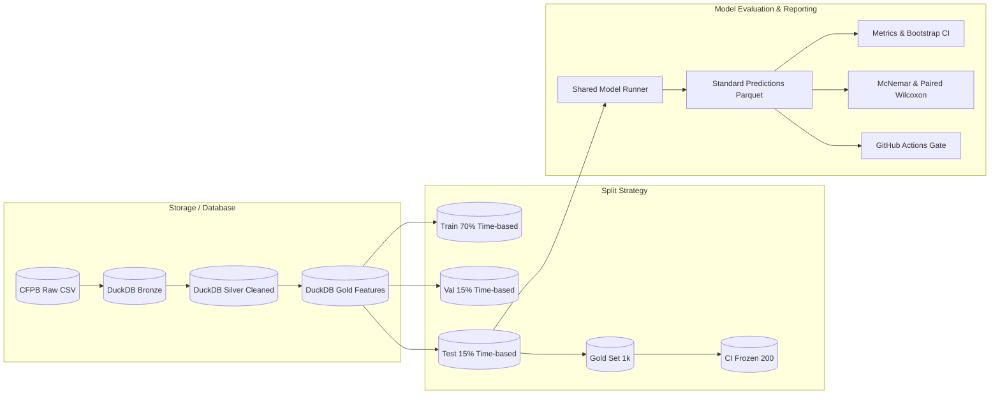

# Architecture & Data Flow

This document details the modular structure, data lineage, and evaluation lifecycle of the Complaint Intelligence system.

## Data Medallion Architecture
1. **Bronze (`01_bronze.sql`):** Direct schema reflection of the raw consumer complaints database.
2. **Silver (`02_silver_clean.sql`):** Normalizes whitespace, deduplicates on narrative and date, sanitizes text, filters short narratives (<50 chars).
3. **Gold (`03_gold_features.sql`):** Feature generation (word count, mask frequency), product consolidation, time-series partitioning.

## Leakage Prevention
- Splits are strictly temporal: train (< 70th percentile date), validation (70th to 85th percentile date), and test (> 85th percentile date).
- Embedding few-shot exemplars for LLMs are strictly sampled from the train split.
